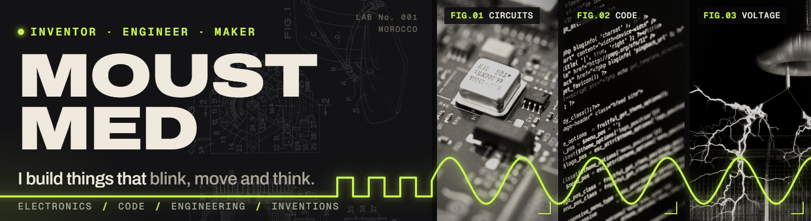

### Hi, I'm Moust Med 👋

Inventor, engineer and maker from Morocco. I build things that blink, move and think, working across
electronics, code and engineering, and I take a project all the way: from a sketch on paper to something
people can use.

## Featured work

<table>
  <tr>
    <td width="72" valign="top"></td>
    <td>
      <b><a href="https://chromewebstore.google.com/detail/reelpilot-%E2%80%93-auto-scroll-f/bphneemeaeekncgbmhfjjhfbplhplced">ReelPilot</a></b> · auto-scroll for Instagram Reels 
      Moves to the next reel for you, puts controls on top of the reel, and keeps playing in background tabs and Picture-in-Picture. 
      <a href="https://chromewebstore.google.com/detail/reelpilot-%E2%80%93-auto-scroll-f/bphneemeaeekncgbmhfjjhfbplhplced">Chrome Web Store</a> ·
      <a href="https://www.youtube.com/watch?v=Ak9mns1-8Ho">46-second demo</a> ·
      <a href="https://github.com/Mousta-Med/IG-Extension">Source</a>
    </td>
  </tr>
  <tr>
    <td width="72" valign="top"></td>
    <td>
      <b><a href="https://chromewebstore.google.com/detail/youtube-global-controls/kdagmajfmfaaamooaohkdhimdojbejdo">YouTube Global Controls</a></b> · control YouTube from any app 
      Global keyboard shortcuts that pause, skip and control YouTube even when Chrome isn't in front. 70+ users, rated 5.0 ★. 
      <a href="https://chromewebstore.google.com/detail/youtube-global-controls/kdagmajfmfaaamooaohkdhimdojbejdo">Chrome Web Store</a> ·
      <a href="https://www.youtube.com/watch?v=OMcBFBkjgBU">33-second demo</a> ·
      <a href="https://github.com/Mousta-Med/YT-Extension">Source</a>
    </td>
  </tr>
</table>

## Stack

Chrome Extensions (Manifest V3) · JavaScript · TypeScript · React · Angular · Node.js · PHP · Laravel ·
Java · Spring Boot · MySQL · PostgreSQL · Docker · GitHub Actions

## Find me

Every link in one place: **[mousta-med.github.io/links](https://mousta-med.github.io/links/)**
